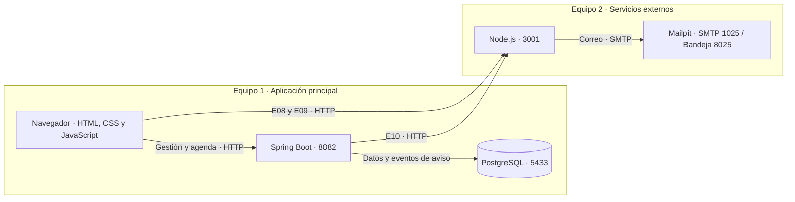

# PetCare | Gestión veterinaria

**Universidad del Bío-Bío · Desarrollo Web Orientado a Objeto · Estudio de Caso 2**

**Integrantes:** Kato Bello Martínez y Jaime Palavecino Suárez.

PetCare centraliza las fichas de clientes y mascotas, la agenda veterinaria y el historial de atención. El sistema se despliega en **dos computadores conectados por la red local**: el primero ejecuta la aplicación web en **Java 21, Spring Boot y PostgreSQL**; el segundo ejecuta la **API Node.js** de medicamentos, ubicación y notificaciones, junto con **Mailpit**.

[Funcionalidades](#funcionalidades) · [Arquitectura](#arquitectura) · [Despliegue](#despliegue-en-dos-computadores) · [Endpoints](#endpoints) · [Verificación](#verificación-del-sistema) · [Pruebas](#pruebas)

## Funcionalidades

| Módulo | Qué permite hacer |
| --- | --- |
| Clientes y mascotas | Registrar, consultar, editar y dar de baja fichas. La baja lógica conserva el historial. |
| Veterinarios y agenda | Registrar y listar profesionales. Filtrar reservas por fecha y veterinario. |
| Reservas | Crear y reprogramar con un selector de horas libres por veterinario y fecha. Confirmar y cancelar. Spring impide solapamientos de reservas activas para la misma mascota o el mismo veterinario. |
| Atención e historial | Registrar diagnóstico, tratamiento y medicamentos. En **Registrar atención**, usa **Elegir del catálogo** para desplegar los medicamentos, revisar una ficha y añadir el nombre. **Agregar manualmente** funciona incluso si la API externa no responde. Al guardar, la reserva confirmada pasa a `ATENDIDA`. |
| Servicios externos | Buscar medicamentos, consultar la ubicación de la clínica y enviar avisos al confirmar, cancelar o reprogramar una reserva confirmada. El catálogo y la ubicación inicial son de demostración. |

## Arquitectura



Spring sirve el frontend en HTML, CSS y JavaScript y publica la dirección del segundo equipo en `GET /api/configuracion`. Desde el equipo 1, el navegador consulta E08 y E09 directamente en Node y Spring llama a E10. Node y la configuración de Mailpit se mantienen en el [repositorio de la API externa](https://github.com/JaimePalavecino/petcare-external-api).

### Estructura del repositorio

```text
petcare-weboo/
├── src/
│   ├── main/
│   │   ├── java/cl/bello/petcare/
│   │   │   ├── controller/           # Entrada HTTP
│   │   │   ├── service/              # Reglas de negocio e integración
│   │   │   ├── repository/           # Acceso a datos con JPA
│   │   │   ├── entity/              # Entidades de base de datos
│   │   │   ├── dto/                 # Datos de entrada y respuesta
│   │   │   ├── config/              # Configuración de Spring
│   │   │   └── exception/           # Excepciones de negocio
│   │   └── resources/
│   │       ├── static/               # index.html, CSS, JS e imágenes
│   │       ├── schema.sql            # Tablas y restricciones
│   │       ├── data.sql              # Veterinaria inicial
│   │       └── application.properties
│   └── test/                         # Pruebas de Spring con H2
├── database/                         # Scripts SQL opcionales
├── postman/                          # Colección y entorno
├── compose.yaml                      # PostgreSQL 17
└── build.gradle                      # Compilación y dependencias
```

## Despliegue en dos computadores

| Equipo | Requisitos | Servicios |
| --- | --- | --- |
| **1 · `petcare-weboo`** | JDK 21 y Docker con Compose. Gradle Wrapper incluido. | Spring y frontend (`8082`), PostgreSQL (`5433`). |
| **2 · `petcare-external-api`** | Node.js 20.6 o posterior, npm y Docker con Compose. | API HTTP (`3001`), SMTP de Mailpit (`1025`) y bandeja de Mailpit (`8025`). |

Conecta ambos equipos a la misma red local. El equipo 1 debe poder acceder al puerto `3001` del equipo 2. PostgreSQL se usa en el equipo 1 y los puertos de Mailpit quedan en el equipo 2.

### 1. Equipo 2: iniciar Node y Mailpit

Sigue las [instrucciones de instalación de la API externa](https://github.com/JaimePalavecino/petcare-external-api#instalación-en-el-equipo-2). Anota la IPv4 del equipo 2 para configurar Spring. La [bandeja de Mailpit](http://127.0.0.1:8025/) se abre desde ese equipo.

### 2. Equipo 1: iniciar PostgreSQL

Con Docker activo, ejecuta desde la raíz de `petcare-weboo` en PowerShell:

```powershell
docker compose up -d postgres
docker compose ps
```

Espera a que `petcare-postgres` aparezca como `healthy`. Spring ejecuta `schema.sql` y `data.sql` al iniciar.

### 3. Equipo 1: conectar Spring con la API externa

Configura `JAVA_HOME` con la ruta de tu JDK 21. Sustituye `192.168.1.25` por la IPv4 real del equipo 2. Si la consulta de ubicación devuelve los datos de la clínica, inicia Spring en esa misma terminal:

```powershell
$env:EXTERNAL_API_URL = 'http://192.168.1.25:3001'
Invoke-RestMethod "$env:EXTERNAL_API_URL/api/ubicacion-clinica"
.\gradlew.bat bootJar
& "$env:JAVA_HOME\bin\java.exe" '-Duser.timezone=America/Santiago' -jar build/libs/petcare-0.0.1-SNAPSHOT.jar
```

Desde el equipo 1, abre **[PetCare](http://127.0.0.1:8082/)**. El frontend se sirve junto con la API y no requiere una compilación aparte. **Medicamentos** abre con el catálogo completo en orden alfabético y permite buscar por nombre completo o parcial (E08). Borra el término o pulsa **Mostrar todos** para recuperar el listado. La vista inicial y el desplegable de la atención se cargan con `GET /api/medicamentos/catalogo`.

<details>
<summary>Configuración de Spring y base separada para pruebas</summary>

| Variable | Configuración local |
| --- | --- |
| `SERVER_PORT` | `8082` |
| `DB_URL` | `jdbc:postgresql://localhost:5433/petcare` |
| `DB_USER` / `DB_PASSWORD` | `postgres` / `postgres` para el Compose local |
| `EXTERNAL_API_URL` | `http://IP_DEL_EQUIPO_2:3001` en el despliegue. El valor predeterminado `http://localhost:3001` sirve para pruebas en un solo equipo. |
| `NOTIFICATION_MAX_ATTEMPTS` / `NOTIFICATION_RETRY_DELAY` | `5` intentos y `30s` de espera inicial |

Las opciones completas están en [application.properties](src/main/resources/application.properties).

Para no mezclar datos de Postman con los de la demostración, crea una base de prueba una sola vez. Define `DB_URL` en la terminal de Spring antes de arrancarlo:

```powershell
docker exec petcare-postgres createdb -U postgres petcare_pruebas
$env:DB_URL = 'jdbc:postgresql://localhost:5433/petcare_pruebas'
```

Si quieres datos de ejemplo, carga [demo-data.sql](database/demo-data.sql) después del primer inicio de Spring sobre esa base. Las citas del script tienen fechas fijas; crea una cita futura para ensayar altas y reprogramaciones.

```powershell
Get-Content -Raw -Encoding UTF8 database/demo-data.sql | docker exec -i petcare-postgres psql -U postgres -d petcare_pruebas -v ON_ERROR_STOP=1
```

</details>

## Endpoints

Las rutas **E01–E07** pertenecen a Spring (puerto `8082`); **E08–E10** pertenecen a Node (puerto `3001`).

| ID | Método | Ruta | Resultado |
| --- | --- | --- | --- |
| E01 | `POST` | `/api/clientes` | `201` · Registra un cliente. |
| E02 | `POST` | `/api/clientes/{clienteId}/mascotas` | `201` · Registra una mascota para ese cliente. |
| E03 | `GET` | `/api/clientes/{clienteId}/mascotas` | `200` · Lista sus mascotas activas. |
| E04 | `POST` | `/api/reservas` | `201` · Crea una reserva en estado `PENDIENTE`. |
| E05 | `PUT` | `/api/reservas/{id}` | `200` · Reprograma el horario o cambia el veterinario. Devuelve el aviso pendiente si la reserva ya estaba confirmada. |
| E06 | `PATCH` | `/api/reservas/{id}/estado` | `200` · Cambia el estado y devuelve el resultado inicial del aviso. |
| E07 | `POST` | `/api/reservas/{id}/atencion` | `201` · Registra una atención. |
| E08 | `GET` | `/api/medicamentos?nombre=AMOX` | `200` · Devuelve coincidencias por nombre. |
| E09 | `GET` | `/api/ubicacion-clinica` | `200` · Devuelve dirección, coordenadas y enlace al mapa. |
| E10 | `POST` | `/api/notificaciones` | `202` · Devuelve un recibo cuando SMTP acepta el correo. |

<details>
<summary>Rutas auxiliares de Spring y validación</summary>

| Método | Ruta | Uso |
| --- | --- | --- |
| `GET` | `/api/configuracion` | Devuelve `externalApiUrl`. |
| `GET` | `/api/clientes` | Lista clientes activos. |
| `GET`, `PUT`, `DELETE` | `/api/clientes/{id}` | Consulta, edición y baja lógica. |
| `GET`, `PUT`, `DELETE` | `/api/mascotas/{id}` | Consulta, edición y baja lógica. |
| `GET` | `/api/mascotas/{id}/historial` | Lista atenciones aunque la mascota esté dada de baja. |
| `GET`, `POST` | `/api/veterinarios` | Lista o registra profesionales. |
| `GET` | `/api/veterinarios/{id}/disponibilidad?fecha=YYYY-MM-DD` | Lista ordenada de horas libres en formato `HH:mm`, o `[]` si no quedan bloques futuros. |
| `GET` | `/api/reservas` | Agenda. Admite `fecha=YYYY-MM-DD` y `veterinarioId` como filtros combinables. |
| `GET` | `/api/reservas/{id}` | Detalle, atención y resultado del último aviso. |

`fechaHora` se envía en ISO local sin zona, por ejemplo `2026-11-27T10:30:00`; debe ser futura al crear o reprogramar. Las bajas devuelven `204`. Spring usa `ApiError` para informar el estado, mensaje, ruta y detalles del error. Los casos más comunes son `400` por datos inválidos, `404` por recurso inexistente y `409` por conflicto.

</details>

### Horario y disponibilidad

La clínica atiende de **08:30 a 19:00**, hora de **America/Santiago**. Cada reserva ocupa 30 minutos; el último inicio es a las **18:30**. Al elegir fecha y veterinario, los formularios de alta y reprogramación muestran sus bloques libres. Las reservas pendientes y confirmadas ocupan el horario. Las citas anteriores que no coinciden con los nuevos bloques se conservan y bloquean los tramos que se solapan. Al cancelar, se liberan los tramos que siguen siendo futuros.

La consulta auxiliar de disponibilidad admite `reservaId` para reprogramar. Debe identificar una reserva pendiente o confirmada; solo se excluye si pertenece al veterinario consultado. Devuelve `400` si la fecha o los identificadores no son válidos, `404` si no encuentra un veterinario activo o la reserva indicada y `409` si esa reserva ya no se puede reprogramar. Al guardar, Spring comprueba nuevamente el bloque y los solapamientos del veterinario y de la mascota. Si el cupo se ocupó, el formulario muestra el conflicto y actualiza las horas sin borrar los otros datos.

### Avisos de reservas

Spring guarda la confirmación, cancelación o reprogramación y su aviso en la misma transacción de PostgreSQL. E06 y, cuando genera un aviso, E05 devuelven `PENDIENTE:<claveEvento>`; después, un proceso en segundo plano llama a E10. Si Node no está disponible, la reserva mantiene el cambio y el aviso puede reintentarse con la misma clave.

Al cambiar la hora o el veterinario de una reserva **confirmada**, se envía un correo «Reserva reprogramada» con los horarios anterior y nuevo, y los nombres de ambos profesionales si cambió el veterinario. Reprogramar una reserva pendiente o guardar los mismos datos devuelve `NO_APLICA` y no genera correo.

El detalle de la reserva consulta el resultado persistido. `ACEPTADA:<idNotificacion>` significa que Mailpit recibió el correo por SMTP y Node registró el recibo. En esta configuración el mensaje queda en la bandeja de pruebas.

## Verificación del sistema

1. **Gestión clínica:** registra y edita un cliente y su mascota, y comprueba la baja lógica con una ficha de prueba. Crea una reserva futura y comprueba que su bloque desaparece para ese veterinario. Verifica el rechazo de un duplicado con Postman o con dos formularios abiertos antes de guardar. Reprograma la reserva y comprueba el nuevo horario.
2. **Estados y persistencia:** confirma la reserva y registra una atención. Recarga el historial y coteja los identificadores de la reserva y la atención en PostgreSQL. Cancela otra reserva y verifica su estado.
3. **Medicamentos y ubicación:** comprueba que [la configuración pública](http://127.0.0.1:8082/api/configuracion) devuelva la IP del equipo 2 en `externalApiUrl`. En la pestaña **Red** del navegador, verifica que **Medicamentos (E08)** y **Clínica (E09)** consulten esa IP.
4. **Notificaciones:** revisa en Mailpit, desde el equipo 2, los correos de confirmación y cancelación. Para verificar la reprogramación, cambia el horario de una reserva ya confirmada antes de registrar su atención y revisa las dos horas en el nuevo correo. Spring invoca E10 desde el servidor, así que esa llamada no aparece en la pestaña **Red** del navegador.

## Pruebas

| Prueba | Cómo ejecutarla |
| --- | --- |
| Spring | `.\gradlew.bat check bootJar`. Las pruebas usan H2 y cubren validación, reservas y avisos persistentes. |
| Node | `npm.cmd test` en el [repositorio externo](https://github.com/JaimePalavecino/petcare-external-api#pruebas). |
| Integración | Importa la [colección](postman/PetCare.postman_collection.json) y el [entorno](postman/PetCare_Local.postman_environment.json) en Postman. Ejecuta todas las solicitudes en orden, desde **Configuración e inicio de una corrida nueva**. |

En Postman, `baseUrl` apunta a Spring y `externalUrl` a Node. Si ejecutas la colección desde el equipo 1, cambia `externalUrl` a la misma dirección del equipo 2 que usa Spring. Usa una base separada y Mailpit. Cada corrida genera datos ficticios y fechas futuras en la hora de Santiago. Mailpit debe capturar una confirmación, una cancelación y un aviso directo de E10.

<details>
<summary>Ejecutar la colección con Newman</summary>

Con los servicios activos y el entorno de Postman ajustado a sus direcciones:

```powershell
npm.cmd exec --yes --package=newman@6.2.1 -- newman run postman/PetCare.postman_collection.json -e postman/PetCare_Local.postman_environment.json --timeout-request 5000 --timeout-script 5000 --timeout 90000
```

</details>

<details>
<summary>Pruebas de desarrollo en un solo computador</summary>

En desarrollo puedes iniciar PostgreSQL, Spring, Node y Mailpit en el mismo PC. Inicia Node con `HOST=127.0.0.1` y arranca Spring con `EXTERNAL_API_URL=http://127.0.0.1:3001`. El entorno **PetCare Local** de Postman ya trae esas direcciones.

</details>
